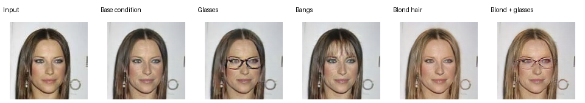

# AttGAN facial attribute editing: reproducible baseline

A TensorFlow 2/Keras reproduction of the facial attribute editor described in the
project report **Unsupervised Image to Image Translation Using GAN**. This implements
the report's concrete AttGAN design. It is **not a new GAN architecture**, a complete
VAE, or a general street-scene/animal translation framework.

The method, reference implementation, and pretrained weights are by
[Zhenliang He and the AttGAN authors](https://github.com/LynnHo/AttGAN-Tensorflow).
See [attribution](THIRD_PARTY.md), [specification decisions](docs/specification.md),
and [next experiment](docs/next-experiment.md). This rebuild used Codex assistance.

## What works

- Original pretrained 128px generator running in modern TensorFlow on CPU.
- All 47 generator weight tensors imported into a native Keras model.
- Single/multiple edits with explicit target values, conflicts checked, adjustable intensity.
- WGAN-GP training with attribute classification and L1 reconstruction; resumable models,
  optimizers, random state, epoch and batch position.
- Deterministic data splits and augmentation; loss logs, TensorBoard, validation grids.
- Reconstruction SSIM/L1 evaluation, kept separate from editing accuracy.

**Measured on Apple M3 / 16 GB, TensorFlow 2.20 CPU:** 23 automated tests passed.
Six inference comparisons with the original graph passed, with maximum absolute error
**1.41e-6 or less**. Warm batch-one inference median: **26.0 ms** across ten runs,
excluding loading and preprocessing. [Raw results](docs/reference-parity.json).
The CLI train/stop/resume/evaluate workflow also passed on twelve synthetic noise images
using a small debug model. These are implementation checks, not model-quality evidence.

## Pretrained demo



Input: the first input cell from upstream's example sheet. The other images were
generated locally with the authors' weights imported into Keras. Base conditioning is
chosen for illustration; source annotations are unavailable. This is **not our training
result, held-out evaluation, or validated reconstruction**.
[Exact provenance and settings](docs/demo-metadata.json).

## Setup

Use Python 3.12 in an isolated environment. TensorFlow 1 is not required.

```sh
python3.12 -m venv .venv
source .venv/bin/activate
python -m pip install -r requirements.lock.txt
python -m scripts.setup_reference
python -m scripts.demo \
  --graph artifacts/upstream/AttGAN_128/generator.pb \
  --upstream-grid artifacts/upstream/sample_validation.jpg
python -m scripts.validate_reference \
  --graph artifacts/upstream/AttGAN_128/generator.pb --image artifacts/demo-input.png
python -m pytest -q
```

Setup downloads approximately 162 MB of model data and an example sheet, verifying
SHA-256 hashes. Weights and datasets are ignored by Git. Publishers control availability.

## Edit an aligned face

Supply source labels; the CLI does not guess them. Order:

```text
Bald, Bangs, Black_Hair, Blond_Hair, Brown_Hair, Bushy_Eyebrows,
Eyeglasses, Male, Mouth_Slightly_Open, Mustache, No_Beard, Pale_Skin, Young
```

These labels are an example, not a universal vector for every image:

```sh
python -m attgan.infer \
  --graph artifacts/upstream/AttGAN_128/generator.pb \
  --image path/to/aligned-face.jpg \
  --labels 0,0,0,0,1,0,0,0,0,0,1,0,1 \
  --set Blond_Hair=1 Eyeglasses=1 --intensity 2 \
  --output artifacts/my-edit.png
```

Use `--backend frozen` to compare the original graph. The default is Keras.
Output includes input, reconstruction, edit, and JSON settings. Preprocessing defaults
to the pretrained checkpoint's 143px resize/128px center crop. Use `--load-size 128`
for already preprocessed 128px inputs. For full-size trained exports replace `--graph`
with `--weights runs/NAME/generator.weights.h5`; the default HQ training uses load size
128. Arbitrary unaligned photos need a separately validated alignment stage.

## Train on CelebA-HQ

Obtain images and binary attributes from the
[official sources](https://github.com/switchablenorms/CelebAMask-HQ). Their current
README directs requests for attribute/identity labels to the CelebA team. Segmentation
masks are not substitutes for binary attributes. On October 8, 2026 the linked Google
Drive archive rejected our download due to quota. No real dataset is installed here.

```sh
python -m attgan.data \
  --annotations data/CelebAMask-HQ/CelebAMask-HQ-attribute-anno.txt \
  --images data/CelebAMask-HQ/CelebA-HQ-img --output data/manifests
python -m attgan.train \
  --images data/CelebAMask-HQ/CelebA-HQ-img \
  --manifests data/manifests --run runs/baseline --max-steps 60
# Continue after reviewing pilot output:
python -m attgan.train \
  --images data/CelebAMask-HQ/CelebA-HQ-img \
  --manifests data/manifests --run runs/baseline --resume
```

Fresh runs refuse existing directories. Resume requires identical settings and manifest
hashes. `--max-steps` counts total batch updates, not images: five D updates then one G
update. Checkpoints save at configured intervals, epoch boundaries, and controlled exit.
Sudden power loss can lose work since the last save. Keep image contents unchanged
between resumes; manifest hashes verify paths and labels, not the image bytes.

Default: 128px HQ, 26,500/500/3,000 train/validation/test, batch 32, 60 epochs, decay
from epoch 30. Splits are image-disjoint, not guaranteed identity-disjoint. Full training,
GPU memory at batch 32, GPU throughput, cost and real-data quality are unmeasured.
No paid compute has been started.

## Evaluate

```sh
python -m attgan.evaluate \
  --images data/CelebAMask-HQ/CelebA-HQ-img --manifest data/manifests/test.json \
  --weights runs/baseline/generator.weights.h5 --config configs/baseline.json \
  --limit 100 --output artifacts/reconstruction.json
tensorboard --logdir runs/baseline/tensorboard
```

Evaluation reports per-image reconstruction SSIM and L1 on `[0,1]` pixels. Editing
accuracy and unedited-attribute preservation remain explicitly unset until an independent
evaluator and held-out protocol are available. SSIM alone cannot show successful editing.
Do not call pretrained evaluation held-out without verifying its original training split.

## Smoke checks without data

```sh
python -m scripts.smoke_fixture
python -m attgan.train --config artifacts/synthetic-smoke/config.json \
  --images artifacts/synthetic-smoke/images --manifests artifacts/synthetic-smoke/manifests \
  --run runs/smoke --max-steps 6
python -m attgan.train --config artifacts/synthetic-smoke/config.json \
  --images artifacts/synthetic-smoke/images --manifests artifacts/synthetic-smoke/manifests \
  --run runs/smoke --resume --max-steps 12
```

The fixture refuses overwrites. Synthetic results only check mechanics.
`python -m scripts.benchmark_training` times the full architecture on synthetic tensors;
it is not a GPU training estimate. CI is configured, but remote CI has not yet run.
Attention and preservation improvements are proposed follow-on experiments, not part
of this baseline. AttGAN means attribute GAN.
